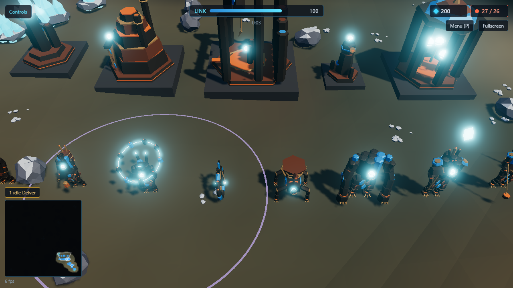
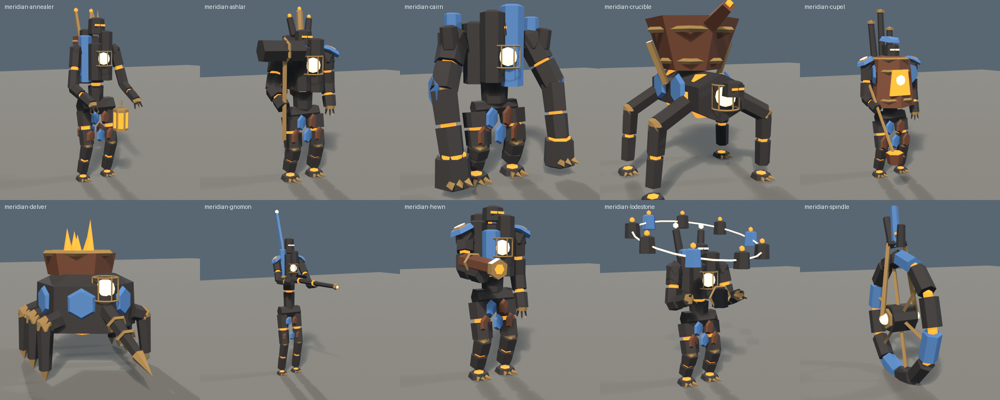
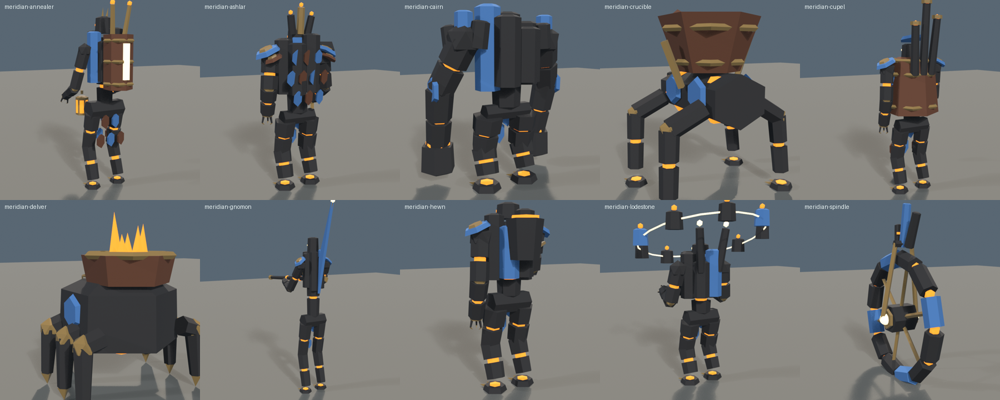
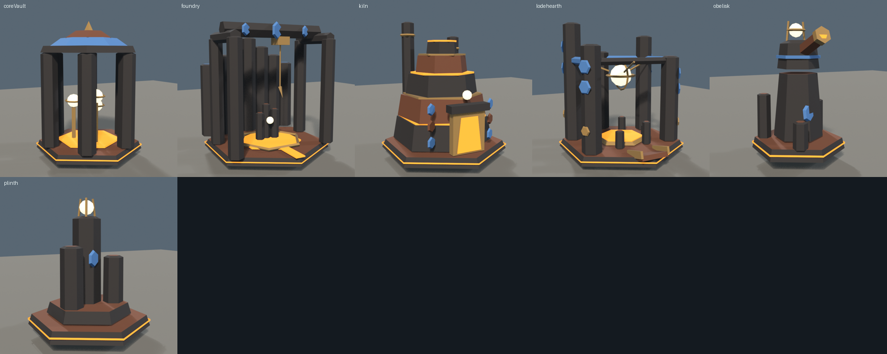
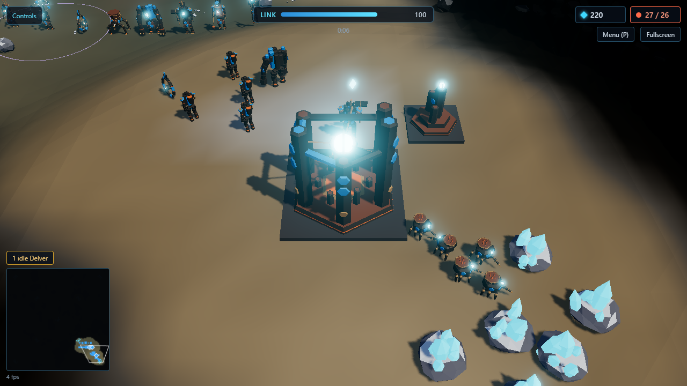

# The Meridian Engines

A third playable side for *Possession RTS* (`cghath/possession-rts`), designed and modeled by
Claude: lore, mechanics, a full roster with numbers in the game's own data format, and every
unit, hero and building built in Blender and checked against the game's model tests.

> The Directorate's mind travels as a **signal**, the Hollow Choir's as a **sound**.
> The Engines' mind travels as an **object**: a burning ore core, carried from body to body.



## What's here

| | |
|---|---|
| [docs/LORE.md](docs/LORE.md) | Who they are: the buried foundry under Calder, woken by the Directorate's mining |
| [docs/DESIGN.md](docs/DESIGN.md) | How they play: core seating and heat, the Kernel, wrecks, the roster, heroes, matchups, the AI, and the code the game needs |
| [data/](data) | `factions`, `units`, `buildings`, `abilities` and `descriptions` entries in the game's formats |
| [models/](models) | 10 unit and hero `.glb`s (Idle and Run animations) and `meridian-buildings.glb` (6 buildings) |
| [tools/blender/](tools/blender) | `meridian.py` (units), `meridian_buildings.py`, `render_models.py`, `check_models.py` |
| [renders/](renders) | Contact sheets and in-game screenshots |

## The side in brief

- **Possession by core, limited by heat.** Seat your core in any frame, anywhere. Fighting heats
  the frame; past the limit it cracks. **Vent** (R) dumps the heat as a blast of slag.
- **Death throws the core free.** You play the **Kernel**, a fast, fragile spark, for 8 s, and
  roll it into another frame or a **wreck**.
- **Wrecks are frames.** Armored units of any side leave wrecks. Delvers salvage them for ore; a
  Kernel can drag one back to its feet for 30 s, even an enemy tank (heroes' wrecks are salvage
  only).
- **Roster:** Delver (worker), Hewn (infantry), Annealer (mends frames), Spindle (wheel scout),
  Cairn (heavy melee), Crucible (molten artillery), Lodestone (grounds enemy links).
- **Heroes:** **Ashlar**, the Mason (walls of columns); **Cupel**, the Refiner (quenches heat,
  pours molten pools); **Gnomon**, the Long Shadow (the longest gun in the game).
- **Buildings:** Lodehearth, Plinth, Kiln, Foundry, Obelisk, Core Vault.






## Checked against the game

The data and models were merged into a scratch copy of `possession-rts` (at `8e98581`, with
stand-ins for the new mechanics listed in DESIGN.md) and pass the game's own tests:

- `factions.test.ts`
- `descriptions.test.ts`
- `modelLibrary.test.ts`: height, layers, triangle budget, the Idle pose and six Run frames, for
  each Engine unit
- `buildings.test.ts`: footprint, floor, height, Team and Glow, the turret head

That is 58 of 58. The screenshots above are from that copy running in the game's renderer.

## Building the models

Blender 5.2, headless:

```
blender -b --factory-startup -P tools/blender/meridian.py -- all models
blender -b --factory-startup -P tools/blender/meridian_buildings.py -- models/meridian-buildings.glb
blender -b --factory-startup -P tools/blender/check_models.py -- models
blender -b --factory-startup -P tools/blender/render_models.py -- renders/units models/meridian-hewn.glb
```

`check_models.py` repeats the game's model rules (budget, Team and Glow, narrower than tall,
run frames that move, buildings on their footprints) without needing the game.

All names, lore and art here are original.
